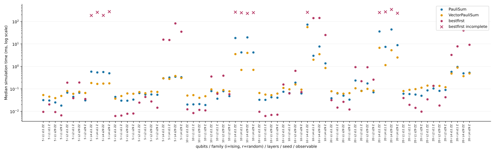
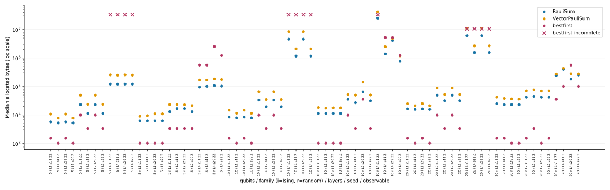
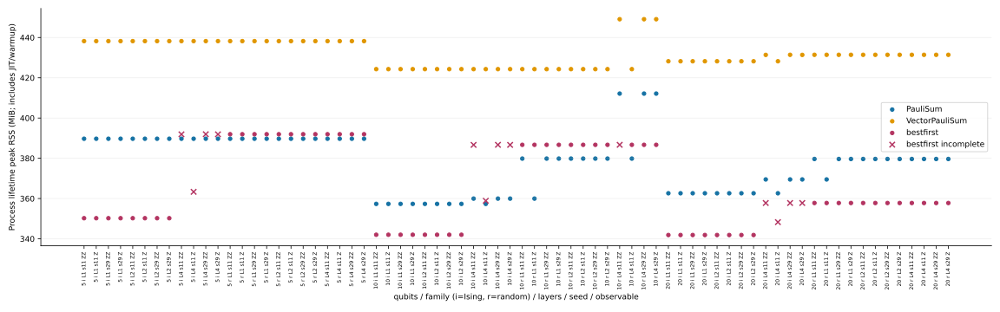
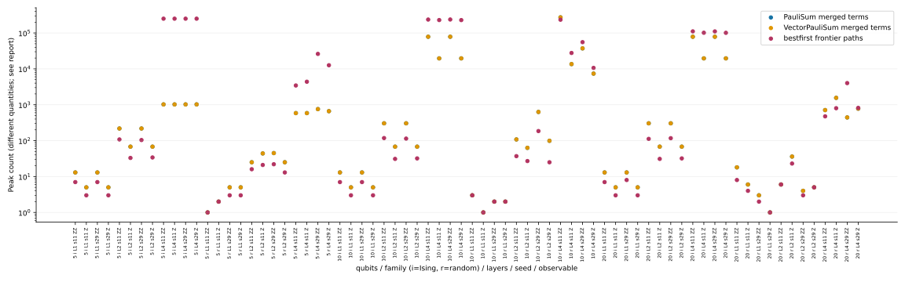
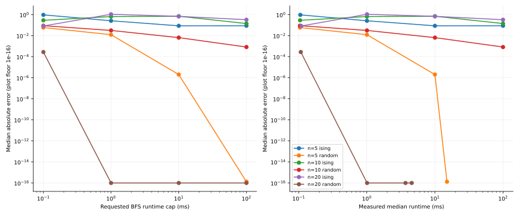
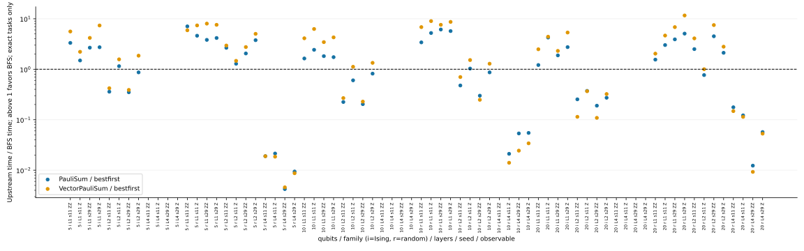

# Best-first Pauli propagation: measured report

Generated from 1200 repeat/failure records. Primary timings use 5 repetitions after a full configuration warmup. No compilation, circuit conversion, reference calculation or plotting is timed.

Environment: Julia 1.13.4, NT (x86_64-w64-mingw32), 13th Gen Intel(R) Core(TM) i7-13700HX; 24 logical CPUs detected, 15.70 GiB RAM. One Julia thread and one BLAS thread. UTC run timestamp: 2026-11-17T04:08:26.984Z.

OS detail: Microsoft Windows [Version 10.0.26300.9974]. Detected GPU (unused): NVIDIA GeForce RTX 4060 Laptop GPU, 610.62, 8188 MiB.

Upstream is registered PauliPropagation 0.9.2, pinned by Manifest.toml. Full metadata, source verification, parameter vectors, explicit circuits, repeat-level data and all package versions are under results/raw and Manifest.toml.

## Observations

- Against PauliSum: BFS is faster in 33/59 completed equivalent cases. Median upstream/BFS runtime ratio is 1.28; range 0.00423–7.06. Ratios below 1 mean BFS is slower.
- Against VectorPauliSum: BFS is faster in 38/59 completed equivalent cases. Median upstream/BFS runtime ratio is 2.04; range 0.00458–11.6. Ratios below 1 mean BFS is slower.
- 13 primary configurations include incomplete results. These are excluded from performance ratios and remain in every results table.
- Incomplete primary repeat reasons: {'expansions': 45, 'frontier': 20}. All upstream primary runs completed exactly in this recorded suite.
- Largest absolute error among validated exact repeats: 6.66e-16.
- Peak observed BFS frontier: 250000 paths. Each live path occupies 48 payload bytes; vector capacity, allocator overhead and runtime memory are additional.

## Interpretation and limits

BFS explores unmerged paths. Upstream combines equal Pauli terms after each gate, allowing cancellation and reconvergence. BFS pays heap insertion/removal, bound bookkeeping and per-operation time checks, and revisits commuting gates separately along every path. Tiny sparse cases can favor the small BFS kernel; larger branching cases can strongly favor merging. These measurements describe this pilot grid, not general 20-qubit scalability.

Several shallow timings are only a few microseconds; relative ratios there are sensitive to scheduling and timer overhead. Worker/backend order was fixed, not randomized. Width alone does not rank difficulty: a local observable has a depth-limited light cone, random draws vary with width, and gate/observable placement changes reconvergence. A 20-qubit case can therefore be easier than a 10-qubit case at the same layer count.

The implemented priority is absolute path coefficient. It bounds the net remaining contribution of that subtree at fixed angles but does not predict its value. The sum of unfinished absolute coefficients gives an absolute error bound (with floating-point allowance); this is not a parameter-uniform LOWESA guarantee. Accuracy need not improve monotonically as budgets grow because partial contributions can cancel.

Primary results have no coefficient or weight truncation. BFS caps are 2,000,000 expansions, 250,000 frontier paths and 2 seconds. These limits are not equivalent to upstream term counts. Every worker additionally has a 3 GiB sampled RSS cap and a 90-second case timeout including warmup/diagnostics. The supervisor runs one worker at a time and polls every 50 ms; caps can overshoot between samples. External failures are recorded and subsequent cases continue.

The budget figure is a BFS-only anytime experiment at 0.1, 1, 10, 100 ms with the same node caps. It is not an equal-cost comparison against upstream; upstream has no matching partial-tree result. No speedup is claimed between partial and exact runs.

RSS is the process-lifetime high-water from Sys.maxrss, including Julia, compilation, warmup and earlier configurations in the same backend/size worker. It is not per-call incremental memory and must not be interpreted as algorithm-only memory. Allocated bytes measure allocation traffic, not peak live memory. External RSS sampling provides an independent safety guard. Peak upstream terms are collected in a separate untimed @peakpaulis pass after gate merging; BFS frontier counts represent unfinished paths. Upstream path/leaf/queue metrics are missing because they have no corresponding meaning.

Exact 5-qubit references use independent dense state-vector evolution and agreement with both upstream backends. Larger references require agreement of both exact upstream backends; these share library kernels and are not fully independent validations. Every exact output and interrupted bound is checked against its available reference at atol=1e-10. Values at the error plot floor are displayed at 1e-16; CSV retains actual errors.

Mean frontier occupancy, heap push/pop counts, allocations and GC time are recorded. Median occupancy and isolated heap-operation time are not measured; instrumenting each heap operation would change the timings. Final unique terms are available for upstream; BFS deliberately does not construct a merged final operator. This is an expectation-value benchmark, so that stronger upstream output is a relevant asymmetry.

Future work: profile heap costs separately; evaluate priorities that account for remaining gates; investigate cancellation-aware merging as a separately specified algorithm; use repeated independent sessions to assess thermal/scheduling variation. No GPU, learned priorities or hybrid DFS were added.

A separate warmed sampling profile of n=10 ising layers=4 seed=11 ZZ_center found heap frames in 170/252 samples (67.5%). This supports queue overhead as a bottleneck on that workload; inclusive stack samples overlap and are not a precise fraction of wall-clock time. See raw/profile_search.txt and raw/profile_search.json.

## Figures

## 5 qubits

| Family | Layers | Seed | Observable | Backend | Status | Median ms | IQR ms | RSS MiB† | Alloc bytes | Abs error | Bound | Peak paths/terms |
|---|---:|---:|---|---|---|---:|---:|---:|---:|---:|---:|---:|
| ising | 1 | 11 | Z_center | PauliSum | exact | 0.0303 | 0.0009 | 389.7 | 5248 | 1.11e-16 | — | 5 |
| ising | 1 | 11 | ZZ_center | PauliSum | exact | 0.0316 | 0.0052 | 389.7 | 5696 | 1.11e-16 | — | 13 |
| ising | 1 | 29 | Z_center | PauliSum | exact | 0.018 | 0.0036 | 389.7 | 5248 | 0 | — | 5 |
| ising | 1 | 29 | ZZ_center | PauliSum | exact | 0.0249 | 0.0092 | 389.7 | 5696 | 2.22e-16 | — | 13 |
| ising | 2 | 11 | Z_center | PauliSum | exact | 0.0443 | 0.0073 | 389.7 | 1.13e+04 | 1.11e-16 | — | 68 |
| ising | 2 | 11 | ZZ_center | PauliSum | exact | 0.068 | 0.0058 | 389.7 | 2.3e+04 | 5.551e-17 | — | 218 |
| ising | 2 | 29 | Z_center | PauliSum | exact | 0.0307 | 0.0061 | 389.7 | 1.13e+04 | 1.11e-16 | — | 68 |
| ising | 2 | 29 | ZZ_center | PauliSum | exact | 0.0672 | 0.0087 | 389.7 | 2.298e+04 | 5.551e-17 | — | 218 |
| ising | 4 | 11 | Z_center | PauliSum | exact | 0.5389 | 0.056 | 389.7 | 1.211e+05 | 3.886e-16 | — | 1023 |
| ising | 4 | 11 | ZZ_center | PauliSum | exact | 0.5853 | 0.0134 | 389.7 | 1.211e+05 | 3.886e-16 | — | 1023 |
| ising | 4 | 29 | Z_center | PauliSum | exact | 0.4941 | 0.0409 | 389.7 | 1.211e+05 | 2.776e-16 | — | 1023 |
| ising | 4 | 29 | ZZ_center | PauliSum | exact | 0.5621 | 0.0033 | 389.7 | 1.211e+05 | 1.11e-16 | — | 1023 |
| random | 1 | 11 | Z_center | PauliSum | exact | 0.03 | 0.003 | 389.7 | 6176 | 0 | — | 2 |
| random | 1 | 11 | ZZ_center | PauliSum | exact | 0.0438 | 0.0134 | 389.7 | 6176 | 4.441e-16 | — | 1 |
| random | 1 | 29 | Z_center | PauliSum | exact | 0.0333 | 0.0113 | 389.7 | 6176 | 0 | — | 5 |
| random | 1 | 29 | ZZ_center | PauliSum | exact | 0.0298 | 0.0007 | 389.7 | 6176 | 1.11e-16 | — | 5 |
| random | 2 | 11 | Z_center | PauliSum | exact | 0.056 | 0.0106 | 389.7 | 1.674e+04 | 1.041e-16 | — | 44 |
| random | 2 | 11 | ZZ_center | PauliSum | exact | 0.0648 | 0.0153 | 389.7 | 1.298e+04 | 6.661e-16 | — | 25 |
| random | 2 | 29 | Z_center | PauliSum | exact | 0.0546 | 0.0039 | 389.7 | 1.298e+04 | 8.327e-17 | — | 25 |
| random | 2 | 29 | ZZ_center | PauliSum | exact | 0.0565 | 0.0111 | 389.7 | 1.674e+04 | 2.776e-16 | — | 45 |
| random | 4 | 11 | Z_center | PauliSum | exact | 0.3204 | 0.0572 | 389.7 | 1.016e+05 | 3.331e-16 | — | 585 |
| random | 4 | 11 | ZZ_center | PauliSum | exact | 0.2954 | 0.0356 | 389.7 | 9.576e+04 | 1.457e-16 | — | 585 |
| random | 4 | 29 | Z_center | PauliSum | exact | 0.3305 | 0.0593 | 389.7 | 1.03e+05 | 2.255e-17 | — | 662 |
| random | 4 | 29 | ZZ_center | PauliSum | exact | 0.3464 | 0.0253 | 389.7 | 1.064e+05 | 1.943e-16 | — | 756 |
| ising | 1 | 11 | Z_center | VectorPauliSum | exact | 0.045 | 0.0129 | 438.2 | 7792 | 1.11e-16 | — | 5 |
| ising | 1 | 11 | ZZ_center | VectorPauliSum | exact | 0.0532 | 0.0141 | 438.2 | 1.074e+04 | 1.11e-16 | — | 13 |
| ising | 1 | 29 | Z_center | VectorPauliSum | exact | 0.0486 | 0.0034 | 438.2 | 7792 | 0 | — | 5 |
| ising | 1 | 29 | ZZ_center | VectorPauliSum | exact | 0.0389 | 0.0017 | 438.2 | 1.074e+04 | 2.22e-16 | — | 13 |
| ising | 2 | 11 | Z_center | VectorPauliSum | exact | 0.0605 | 0.0008 | 438.2 | 2.375e+04 | 1.11e-16 | — | 68 |
| ising | 2 | 11 | ZZ_center | VectorPauliSum | exact | 0.0798 | 0.0122 | 438.2 | 4.945e+04 | 5.551e-17 | — | 218 |
| ising | 2 | 29 | Z_center | VectorPauliSum | exact | 0.0657 | 0.0157 | 438.2 | 2.375e+04 | 1.11e-16 | — | 68 |
| ising | 2 | 29 | ZZ_center | VectorPauliSum | exact | 0.0747 | 0.02 | 438.2 | 4.942e+04 | 5.551e-17 | — | 218 |
| ising | 4 | 11 | Z_center | VectorPauliSum | exact | 0.1665 | 0.0076 | 438.2 | 2.494e+05 | 2.776e-16 | — | 1023 |
| ising | 4 | 11 | ZZ_center | VectorPauliSum | exact | 0.1826 | 0.0069 | 438.2 | 2.539e+05 | 3.886e-16 | — | 1023 |
| ising | 4 | 29 | Z_center | VectorPauliSum | exact | 0.1757 | 0.0085 | 438.2 | 2.495e+05 | 1.11e-16 | — | 1023 |
| ising | 4 | 29 | ZZ_center | VectorPauliSum | exact | 0.1721 | 0.0349 | 438.2 | 2.54e+05 | 1.11e-16 | — | 1023 |
| random | 1 | 11 | Z_center | VectorPauliSum | exact | 0.048 | 0.0098 | 438.2 | 9456 | 0 | — | 2 |
| random | 1 | 11 | ZZ_center | VectorPauliSum | exact | 0.0367 | 0.0023 | 438.2 | 9040 | 4.441e-16 | — | 1 |
| random | 1 | 29 | Z_center | VectorPauliSum | exact | 0.0607 | 0.0017 | 438.2 | 1.094e+04 | 0 | — | 5 |
| random | 1 | 29 | ZZ_center | VectorPauliSum | exact | 0.0625 | 0.0149 | 438.2 | 1.094e+04 | 1.11e-16 | — | 5 |
| random | 2 | 11 | Z_center | VectorPauliSum | exact | 0.064 | 0.016 | 438.2 | 2.349e+04 | 1.041e-16 | — | 44 |
| random | 2 | 11 | ZZ_center | VectorPauliSum | exact | 0.072 | 0.007 | 438.2 | 2.317e+04 | 6.661e-16 | — | 25 |
| random | 2 | 29 | Z_center | VectorPauliSum | exact | 0.0729 | 0.0026 | 438.2 | 2.139e+04 | 8.327e-17 | — | 25 |
| random | 2 | 29 | ZZ_center | VectorPauliSum | exact | 0.0757 | 0.0186 | 438.2 | 2.288e+04 | 2.776e-16 | — | 45 |
| random | 4 | 11 | Z_center | VectorPauliSum | exact | 0.2776 | 0.0098 | 438.2 | 1.691e+05 | 3.331e-16 | — | 585 |
| random | 4 | 11 | ZZ_center | VectorPauliSum | exact | 0.2944 | 0.0153 | 438.2 | 1.692e+05 | 1.527e-16 | — | 585 |
| random | 4 | 29 | Z_center | VectorPauliSum | exact | 0.3056 | 0.0456 | 438.2 | 1.758e+05 | 2.255e-17 | — | 662 |
| random | 4 | 29 | ZZ_center | VectorPauliSum | exact | 0.375 | 0.0206 | 438.2 | 1.849e+05 | 2.082e-16 | — | 756 |
| ising | 1 | 11 | Z_center | bestfirst | exact | 0.0203 | 0.0085 | 350.2 | 1024 | 1.11e-16 | 0 | 3 |
| ising | 1 | 11 | ZZ_center | bestfirst | exact | 0.0095 | 0.0033 | 350.2 | 1520 | 1.11e-16 | 0 | 7 |
| ising | 1 | 29 | Z_center | bestfirst | exact | 0.0066 | 0.0011 | 350.2 | 1024 | 0 | 0 | 3 |
| ising | 1 | 29 | ZZ_center | bestfirst | exact | 0.0093 | 0.0003 | 350.2 | 1520 | 2.22e-16 | 0 | 7 |
| ising | 2 | 11 | Z_center | bestfirst | exact | 0.0385 | 0.0062 | 350.2 | 3328 | 1.11e-16 | 0 | 33 |
| ising | 2 | 11 | ZZ_center | bestfirst | exact | 0.1894 | 0.0458 | 350.2 | 9879 | 5.551e-17 | 0 | 108 |
| ising | 2 | 29 | Z_center | bestfirst | exact | 0.0354 | 0.0159 | 350.2 | 3328 | 0 | 0 | 34 |
| ising | 2 | 29 | ZZ_center | bestfirst | exact | 0.1918 | 0.0093 | 350.2 | 9879 | 1.665e-16 | 0 | 104 |
| ising | 4 | 11 | Z_center | bestfirst | resource_limited | 255.7 | 6.063 | 363.3 | 3.308e+07 | 0.0006687 | 0.1567 | 2.5e+05 |
| ising | 4 | 11 | ZZ_center | bestfirst | resource_limited | 185 | 4.368 | 391.9 | 3.308e+07 | 0.07235 | 6.087 | 2.5e+05 |
| ising | 4 | 29 | Z_center | bestfirst | resource_limited | 273.8 | 14.94 | 391.9 | 3.308e+07 | 0.0007259 | 0.1559 | 2.5e+05 |
| ising | 4 | 29 | ZZ_center | bestfirst | resource_limited | 186.6 | 4.651 | 392 | 3.308e+07 | 0.06692 | 5.676 | 2.5e+05 |
| random | 1 | 11 | Z_center | bestfirst | exact | 0.0065 | 0.0005 | 392 | 1024 | 0 | 0 | 2 |
| random | 1 | 11 | ZZ_center | bestfirst | exact | 0.0062 | 0.0039 | 392 | 1024 | 4.441e-16 | 0 | 1 |
| random | 1 | 29 | Z_center | bestfirst | exact | 0.008 | 0.0005 | 392 | 1024 | 0 | 0 | 3 |
| random | 1 | 29 | ZZ_center | bestfirst | exact | 0.0078 | 0.0005 | 392 | 1024 | 1.11e-16 | 0 | 3 |
| random | 2 | 11 | Z_center | bestfirst | exact | 0.0436 | 0.0035 | 392 | 3328 | 1.041e-16 | 0 | 21 |
| random | 2 | 11 | ZZ_center | bestfirst | exact | 0.0244 | 0.0014 | 392 | 3328 | 6.661e-16 | 0 | 16 |
| random | 2 | 29 | Z_center | bestfirst | exact | 0.0145 | 0.0014 | 392 | 3328 | 8.327e-17 | 0 | 13 |
| random | 2 | 29 | ZZ_center | bestfirst | exact | 0.0275 | 0.0101 | 392 | 3328 | 2.776e-16 | 0 | 22 |
| random | 4 | 11 | Z_center | bestfirst | exact | 14.97 | 0.5276 | 392 | 5.626e+05 | 3.053e-16 | 0 | 4384 |
| random | 4 | 11 | ZZ_center | bestfirst | exact | 15.55 | 2.58 | 392 | 5.626e+05 | 1.318e-16 | 0 | 3444 |
| random | 4 | 29 | Z_center | bestfirst | exact | 35.07 | 0.9324 | 392 | 1.21e+06 | 2.949e-17 | 0 | 1.262e+04 |
| random | 4 | 29 | ZZ_center | bestfirst | exact | 81.91 | 0.4095 | 392 | 2.529e+06 | 1.665e-16 | 0 | 2.61e+04 |

† Process-lifetime high-water, not per-call incremental RSS.

## 10 qubits

| Family | Layers | Seed | Observable | Backend | Status | Median ms | IQR ms | RSS MiB† | Alloc bytes | Abs error | Bound | Peak paths/terms |
|---|---:|---:|---|---|---|---:|---:|---:|---:|---:|---:|---:|
| ising | 1 | 11 | Z_center | PauliSum | exact | 0.0204 | 0.0022 | 357.3 | 7936 | 0 | — | 5 |
| ising | 1 | 11 | ZZ_center | PauliSum | exact | 0.0201 | 0.0014 | 357.3 | 8448 | 0 | — | 13 |
| ising | 1 | 29 | Z_center | PauliSum | exact | 0.0191 | 0.0002 | 357.3 | 7936 | 0 | — | 5 |
| ising | 1 | 29 | ZZ_center | PauliSum | exact | 0.0211 | 0.0011 | 357.3 | 8448 | 0 | — | 13 |
| ising | 2 | 11 | Z_center | PauliSum | exact | 0.0365 | 0.0022 | 357.3 | 1.955e+04 | 0 | — | 68 |
| ising | 2 | 11 | ZZ_center | PauliSum | exact | 0.0795 | 0.0022 | 357.3 | 3.334e+04 | 0 | — | 304 |
| ising | 2 | 29 | Z_center | PauliSum | exact | 0.0475 | 0.0124 | 357.3 | 1.955e+04 | 0 | — | 68 |
| ising | 2 | 29 | ZZ_center | PauliSum | exact | 0.0786 | 0.0031 | 357.3 | 3.332e+04 | 0 | — | 304 |
| ising | 4 | 11 | Z_center | PauliSum | exact | 4.2 | 0.1006 | 357.3 | 1.164e+06 | 0 | — | 1.96e+04 |
| ising | 4 | 11 | ZZ_center | PauliSum | exact | 18.34 | 1.798 | 360 | 4.572e+06 | 0 | — | 7.84e+04 |
| ising | 4 | 29 | Z_center | PauliSum | exact | 4.174 | 0.1298 | 360 | 1.164e+06 | 0 | — | 1.96e+04 |
| ising | 4 | 29 | ZZ_center | PauliSum | exact | 19.57 | 2.633 | 360 | 4.572e+06 | 0 | — | 7.84e+04 |
| random | 1 | 11 | Z_center | PauliSum | exact | 0.0324 | 0.0005 | 360 | 1.128e+04 | 0 | — | 1 |
| random | 1 | 11 | ZZ_center | PauliSum | exact | 0.0327 | 0.009 | 379.8 | 1.128e+04 | 0 | — | 3 |
| random | 1 | 29 | Z_center | PauliSum | exact | 0.0405 | 0.0139 | 379.8 | 1.128e+04 | 0 | — | 2 |
| random | 1 | 29 | ZZ_center | PauliSum | exact | 0.0423 | 0.0116 | 379.8 | 1.128e+04 | 0 | — | 2 |
| random | 2 | 11 | Z_center | PauliSum | exact | 0.0648 | 0.0045 | 379.8 | 2.682e+04 | 0 | — | 63 |
| random | 2 | 11 | ZZ_center | PauliSum | exact | 0.0745 | 0.0154 | 379.8 | 3.544e+04 | 0 | — | 108 |
| random | 2 | 29 | Z_center | PauliSum | exact | 0.0626 | 0.002 | 379.8 | 3.125e+04 | 0 | — | 99 |
| random | 2 | 29 | ZZ_center | PauliSum | exact | 0.1898 | 0.0137 | 379.8 | 6.415e+04 | 0 | — | 630 |
| random | 4 | 11 | Z_center | PauliSum | exact | 2.982 | 0.0873 | 379.8 | 1.377e+06 | 0 | — | 1.357e+04 |
| random | 4 | 11 | ZZ_center | PauliSum | exact | 72.45 | 0.5489 | 412.1 | 2.498e+07 | 0 | — | 2.719e+05 |
| random | 4 | 29 | Z_center | PauliSum | exact | 1.366 | 0.0691 | 412.1 | 7.658e+05 | 0 | — | 7367 |
| random | 4 | 29 | ZZ_center | PauliSum | exact | 7.666 | 1.165 | 412.1 | 4.103e+06 | 0 | — | 3.719e+04 |
| ising | 1 | 11 | Z_center | VectorPauliSum | exact | 0.0527 | 0.0036 | 424.3 | 1.147e+04 | 0 | — | 5 |
| ising | 1 | 11 | ZZ_center | VectorPauliSum | exact | 0.0505 | 0.007 | 424.3 | 1.469e+04 | 0 | — | 13 |
| ising | 1 | 29 | Z_center | VectorPauliSum | exact | 0.0471 | 0.0076 | 424.3 | 1.147e+04 | 0 | — | 5 |
| ising | 1 | 29 | ZZ_center | VectorPauliSum | exact | 0.04 | 0.0027 | 424.3 | 1.469e+04 | 0 | — | 13 |
| ising | 2 | 11 | Z_center | VectorPauliSum | exact | 0.0677 | 0.0143 | 424.3 | 3.469e+04 | 0 | — | 68 |
| ising | 2 | 11 | ZZ_center | VectorPauliSum | exact | 0.095 | 0.0094 | 424.3 | 6.478e+04 | 0 | — | 304 |
| ising | 2 | 29 | Z_center | VectorPauliSum | exact | 0.0777 | 0.0117 | 424.3 | 3.469e+04 | 0 | — | 68 |
| ising | 2 | 29 | ZZ_center | VectorPauliSum | exact | 0.0882 | 0.0254 | 424.3 | 6.473e+04 | 0 | — | 304 |
| ising | 4 | 11 | Z_center | VectorPauliSum | exact | 0.6979 | 0.3116 | 424.3 | 2.101e+06 | 5.551e-17 | — | 1.96e+04 |
| ising | 4 | 11 | ZZ_center | VectorPauliSum | exact | 3.527 | 0.3088 | 424.3 | 8.427e+06 | 2.776e-16 | — | 7.84e+04 |
| ising | 4 | 29 | Z_center | VectorPauliSum | exact | 0.702 | 0.3672 | 424.3 | 2.101e+06 | 0 | — | 1.96e+04 |
| ising | 4 | 29 | ZZ_center | VectorPauliSum | exact | 3.987 | 0.2942 | 424.3 | 8.427e+06 | 1.665e-16 | — | 7.84e+04 |
| random | 1 | 11 | Z_center | VectorPauliSum | exact | 0.0558 | 0.0014 | 424.3 | 1.742e+04 | 0 | — | 1 |
| random | 1 | 11 | ZZ_center | VectorPauliSum | exact | 0.0656 | 0.002 | 424.3 | 1.826e+04 | 0 | — | 3 |
| random | 1 | 29 | Z_center | VectorPauliSum | exact | 0.0616 | 0.0038 | 424.3 | 1.784e+04 | 0 | — | 2 |
| random | 1 | 29 | ZZ_center | VectorPauliSum | exact | 0.0524 | 0.0239 | 424.3 | 1.784e+04 | 0 | — | 2 |
| random | 2 | 11 | Z_center | VectorPauliSum | exact | 0.0956 | 0.0174 | 424.3 | 4.965e+04 | 0 | — | 63 |
| random | 2 | 11 | ZZ_center | VectorPauliSum | exact | 0.1095 | 0.0076 | 424.3 | 5.172e+04 | 0 | — | 108 |
| random | 2 | 29 | Z_center | VectorPauliSum | exact | 0.093 | 0.0221 | 424.3 | 5.012e+04 | 0 | — | 99 |
| random | 2 | 29 | ZZ_center | VectorPauliSum | exact | 0.1574 | 0.0141 | 424.3 | 1.416e+05 | 0 | — | 630 |
| random | 4 | 11 | Z_center | VectorPauliSum | exact | 1.983 | 0.1374 | 424.3 | 2.478e+06 | 6.939e-18 | — | 1.357e+04 |
| random | 4 | 11 | ZZ_center | VectorPauliSum | exact | 56.17 | 1.586 | 449.1 | 4.2e+07 | 6.939e-17 | — | 2.719e+05 |
| random | 4 | 29 | Z_center | VectorPauliSum | exact | 0.8497 | 0.0473 | 449.1 | 1.176e+06 | 2.776e-17 | — | 7367 |
| random | 4 | 29 | ZZ_center | VectorPauliSum | exact | 3.495 | 0.6058 | 449.1 | 4.834e+06 | 0 | — | 3.719e+04 |
| ising | 1 | 11 | Z_center | bestfirst | exact | 0.0084 | 0.0044 | 342 | 1024 | 0 | 0 | 3 |
| ising | 1 | 11 | ZZ_center | bestfirst | exact | 0.0123 | 0.0039 | 342 | 1520 | 0 | 0 | 7 |
| ising | 1 | 29 | Z_center | bestfirst | exact | 0.011 | 0.003 | 342 | 1024 | 0 | 0 | 3 |
| ising | 1 | 29 | ZZ_center | bestfirst | exact | 0.0116 | 0.0015 | 342 | 1520 | 0 | 0 | 7 |
| ising | 2 | 11 | Z_center | bestfirst | exact | 0.0605 | 0.0098 | 342 | 3328 | 0 | 0 | 31 |
| ising | 2 | 11 | ZZ_center | bestfirst | exact | 0.354 | 0.0387 | 342 | 9831 | 0 | 0 | 118 |
| ising | 2 | 29 | Z_center | bestfirst | exact | 0.058 | 0.0016 | 342 | 3328 | 0 | 0 | 32 |
| ising | 2 | 29 | ZZ_center | bestfirst | exact | 0.386 | 0.1348 | 342 | 9831 | 5.551e-17 | 0 | 114 |
| ising | 4 | 11 | Z_center | bestfirst | resource_limited | 244.7 | 16.5 | 358.9 | 3.308e+07 | 0.004308 | 0.7027 | 2.29e+05 |
| ising | 4 | 11 | ZZ_center | bestfirst | resource_limited | 260.9 | 22.91 | 386.7 | 3.308e+07 | 0.112 | 10.48 | 2.363e+05 |
| ising | 4 | 29 | Z_center | bestfirst | resource_limited | 247.5 | 33.86 | 386.7 | 3.308e+07 | 0.003837 | 0.5953 | 2.284e+05 |
| ising | 4 | 29 | ZZ_center | bestfirst | resource_limited | 228.8 | 12.33 | 386.7 | 3.308e+07 | 0.1083 | 9.899 | 2.372e+05 |
| random | 1 | 11 | Z_center | bestfirst | exact | 0.0062 | 0.0002 | 386.7 | 1024 | 0 | 0 | 1 |
| random | 1 | 11 | ZZ_center | bestfirst | exact | 0.0096 | 0.003 | 386.7 | 1024 | 0 | 0 | 3 |
| random | 1 | 29 | Z_center | bestfirst | exact | 0.0071 | 0.0003 | 386.7 | 1024 | 0 | 0 | 2 |
| random | 1 | 29 | ZZ_center | bestfirst | exact | 0.0069 | 0.0001 | 386.7 | 1024 | 0 | 0 | 2 |
| random | 2 | 11 | Z_center | bestfirst | exact | 0.0628 | 0.0058 | 386.7 | 3328 | 0 | 0 | 27 |
| random | 2 | 11 | ZZ_center | bestfirst | exact | 0.1562 | 0.0261 | 386.7 | 9831 | 0 | 0 | 37 |
| random | 2 | 29 | Z_center | bestfirst | exact | 0.0722 | 0.0181 | 386.7 | 3328 | 0 | 0 | 25 |
| random | 2 | 29 | ZZ_center | bestfirst | exact | 0.6337 | 0.1117 | 386.7 | 3.557e+04 | 5.551e-17 | 0 | 185 |
| random | 4 | 11 | Z_center | bestfirst | exact | 141.2 | 6.174 | 386.7 | 5.191e+06 | 1.388e-17 | 0 | 2.769e+04 |
| random | 4 | 11 | ZZ_center | bestfirst | resource_limited | 256.3 | 2.386 | 386.7 | 3.308e+07 | 0.0006255 | 5.445 | 2.342e+05 |
| random | 4 | 29 | Z_center | bestfirst | exact | 24.93 | 0.1953 | 386.7 | 1.21e+06 | 5.551e-17 | 0 | 1.063e+04 |
| random | 4 | 29 | ZZ_center | bestfirst | exact | 143.2 | 4.062 | 386.7 | 5.191e+06 | 8.327e-17 | 0 | 5.539e+04 |

† Process-lifetime high-water, not per-call incremental RSS.

## 20 qubits

| Family | Layers | Seed | Observable | Backend | Status | Median ms | IQR ms | RSS MiB† | Alloc bytes | Abs error | Bound | Peak paths/terms |
|---|---:|---:|---|---|---|---:|---:|---:|---:|---:|---:|---:|
| ising | 1 | 11 | Z_center | PauliSum | exact | 0.0624 | 0.0318 | 362.6 | 1.568e+04 | 0 | — | 5 |
| ising | 1 | 11 | ZZ_center | PauliSum | exact | 0.0381 | 0.0054 | 362.6 | 1.632e+04 | 0 | — | 13 |
| ising | 1 | 29 | Z_center | PauliSum | exact | 0.0332 | 0.0074 | 362.6 | 1.568e+04 | 0 | — | 5 |
| ising | 1 | 29 | ZZ_center | PauliSum | exact | 0.0499 | 0.0199 | 362.6 | 1.632e+04 | 0 | — | 13 |
| ising | 2 | 11 | Z_center | PauliSum | exact | 0.0815 | 0.0094 | 362.6 | 3.149e+04 | 0 | — | 68 |
| ising | 2 | 11 | ZZ_center | PauliSum | exact | 0.2359 | 0.0849 | 362.6 | 4.939e+04 | 0 | — | 304 |
| ising | 2 | 29 | Z_center | PauliSum | exact | 0.0702 | 0.0172 | 362.6 | 3.149e+04 | 0 | — | 68 |
| ising | 2 | 29 | ZZ_center | PauliSum | exact | 0.1745 | 0.0192 | 362.6 | 4.935e+04 | 0 | — | 304 |
| ising | 4 | 11 | Z_center | PauliSum | exact | 7.391 | 2.26 | 362.6 | 1.543e+06 | 0 | — | 1.96e+04 |
| ising | 4 | 11 | ZZ_center | PauliSum | exact | 35.9 | 4.897 | 369.5 | 6e+06 | 0 | — | 7.84e+04 |
| ising | 4 | 29 | Z_center | PauliSum | exact | 8.811 | 2.712 | 369.5 | 1.543e+06 | 0 | — | 1.96e+04 |
| ising | 4 | 29 | ZZ_center | PauliSum | exact | 44.04 | 17.27 | 369.5 | 6e+06 | 0 | — | 7.84e+04 |
| random | 1 | 11 | Z_center | PauliSum | exact | 0.0588 | 0.0019 | 369.5 | 2.298e+04 | 0 | — | 6 |
| random | 1 | 11 | ZZ_center | PauliSum | exact | 0.0608 | 0.0049 | 379.7 | 2.48e+04 | 0 | — | 18 |
| random | 1 | 29 | Z_center | PauliSum | exact | 0.0493 | 0.0105 | 379.7 | 2.298e+04 | 0 | — | 1 |
| random | 1 | 29 | ZZ_center | PauliSum | exact | 0.0559 | 0.0277 | 379.7 | 2.298e+04 | 0 | — | 3 |
| random | 2 | 11 | Z_center | PauliSum | exact | 0.104 | 0.0018 | 379.7 | 4.504e+04 | 0 | — | 36 |
| random | 2 | 11 | ZZ_center | PauliSum | exact | 0.0857 | 0.0024 | 379.7 | 4.203e+04 | 0 | — | 6 |
| random | 2 | 29 | Z_center | PauliSum | exact | 0.0898 | 0.016 | 379.7 | 4.203e+04 | 0 | — | 5 |
| random | 2 | 29 | ZZ_center | PauliSum | exact | 0.0815 | 0.0044 | 379.7 | 4.203e+04 | 0 | — | 4 |
| random | 4 | 11 | Z_center | PauliSum | exact | 0.9504 | 0.4084 | 379.7 | 4e+05 | 0 | — | 1557 |
| random | 4 | 11 | ZZ_center | PauliSum | exact | 0.5722 | 0.1593 | 379.7 | 2.431e+05 | 0 | — | 711 |
| random | 4 | 29 | Z_center | PauliSum | exact | 0.5226 | 0.0679 | 379.7 | 2.519e+05 | 0 | — | 779 |
| random | 4 | 29 | ZZ_center | PauliSum | exact | 0.4898 | 0.0084 | 379.7 | 1.821e+05 | 0 | — | 443 |
| ising | 1 | 11 | Z_center | VectorPauliSum | exact | 0.0649 | 0.0115 | 428.2 | 2.117e+04 | 0 | — | 5 |
| ising | 1 | 11 | ZZ_center | VectorPauliSum | exact | 0.0781 | 0.0282 | 428.2 | 2.498e+04 | 0 | — | 13 |
| ising | 1 | 29 | Z_center | VectorPauliSum | exact | 0.0646 | 0.0042 | 428.2 | 2.117e+04 | 0 | — | 5 |
| ising | 1 | 29 | ZZ_center | VectorPauliSum | exact | 0.0612 | 0.0273 | 428.2 | 2.498e+04 | 0 | — | 13 |
| ising | 2 | 11 | Z_center | VectorPauliSum | exact | 0.0803 | 0.0017 | 428.2 | 5.221e+04 | 0 | — | 68 |
| ising | 2 | 11 | ZZ_center | VectorPauliSum | exact | 0.1062 | 0.0143 | 428.2 | 8.906e+04 | 0 | — | 304 |
| ising | 2 | 29 | Z_center | VectorPauliSum | exact | 0.0831 | 0.0186 | 428.2 | 5.221e+04 | 0 | — | 68 |
| ising | 2 | 29 | ZZ_center | VectorPauliSum | exact | 0.1001 | 0.0304 | 428.2 | 8.906e+04 | 0 | — | 304 |
| ising | 4 | 11 | Z_center | VectorPauliSum | exact | 1.143 | 0.3979 | 428.2 | 2.661e+06 | 5.551e-17 | — | 1.96e+04 |
| ising | 4 | 11 | ZZ_center | VectorPauliSum | exact | 6.716 | 0.8215 | 431.4 | 1.059e+07 | 5.551e-17 | — | 7.84e+04 |
| ising | 4 | 29 | Z_center | VectorPauliSum | exact | 2.494 | 1.837 | 431.4 | 2.661e+06 | 5.551e-17 | — | 1.96e+04 |
| ising | 4 | 29 | ZZ_center | VectorPauliSum | exact | 5.24 | 3.645 | 431.4 | 1.059e+07 | 5.551e-17 | — | 7.84e+04 |
| random | 1 | 11 | Z_center | VectorPauliSum | exact | 0.0907 | 0.015 | 431.4 | 3.8e+04 | 0 | — | 6 |
| random | 1 | 11 | ZZ_center | VectorPauliSum | exact | 0.0799 | 0.0081 | 431.4 | 4.218e+04 | 0 | — | 18 |
| random | 1 | 29 | Z_center | VectorPauliSum | exact | 0.1128 | 0.0181 | 431.4 | 3.59e+04 | 0 | — | 1 |
| random | 1 | 29 | ZZ_center | VectorPauliSum | exact | 0.0977 | 0.0131 | 431.4 | 3.674e+04 | 0 | — | 3 |
| random | 2 | 11 | Z_center | VectorPauliSum | exact | 0.1358 | 0.0348 | 431.4 | 7.61e+04 | 0 | — | 36 |
| random | 2 | 11 | ZZ_center | VectorPauliSum | exact | 0.1399 | 0.0182 | 431.4 | 6.97e+04 | 0 | — | 6 |
| random | 2 | 29 | Z_center | VectorPauliSum | exact | 0.1186 | 0.0253 | 431.4 | 6.97e+04 | 0 | — | 5 |
| random | 2 | 29 | ZZ_center | VectorPauliSum | exact | 0.1358 | 0.0302 | 431.4 | 6.886e+04 | 0 | — | 4 |
| random | 4 | 11 | Z_center | VectorPauliSum | exact | 0.8857 | 0.4182 | 431.4 | 4.361e+05 | 0 | — | 1557 |
| random | 4 | 11 | ZZ_center | VectorPauliSum | exact | 0.4805 | 0.2222 | 431.4 | 2.7e+05 | 0 | — | 711 |
| random | 4 | 29 | Z_center | VectorPauliSum | exact | 0.486 | 0.1774 | 431.4 | 2.728e+05 | 0 | — | 779 |
| random | 4 | 29 | ZZ_center | VectorPauliSum | exact | 0.3687 | 0.0452 | 431.4 | 2.755e+05 | 0 | — | 443 |
| ising | 1 | 11 | Z_center | bestfirst | exact | 0.0147 | 0.0058 | 341.9 | 1024 | 0 | 0 | 3 |
| ising | 1 | 11 | ZZ_center | bestfirst | exact | 0.0314 | 0.0121 | 341.9 | 1520 | 0 | 0 | 7 |
| ising | 1 | 29 | Z_center | bestfirst | exact | 0.0121 | 0.0033 | 341.9 | 1024 | 0 | 0 | 3 |
| ising | 1 | 29 | ZZ_center | bestfirst | exact | 0.0265 | 0.0077 | 341.9 | 1520 | 0 | 0 | 8 |
| ising | 2 | 11 | Z_center | bestfirst | exact | 0.2188 | 0.0453 | 341.9 | 3328 | 0 | 0 | 31 |
| ising | 2 | 11 | ZZ_center | bestfirst | exact | 0.93 | 0.0521 | 341.9 | 9863 | 5.551e-17 | 0 | 112 |
| ising | 2 | 29 | Z_center | bestfirst | exact | 0.2575 | 0.0994 | 341.9 | 3328 | 0 | 0 | 32 |
| ising | 2 | 29 | ZZ_center | bestfirst | exact | 0.9195 | 0.2174 | 341.9 | 9863 | 0 | 0 | 117 |
| ising | 4 | 11 | Z_center | bestfirst | resource_limited | 267.9 | 30.95 | 348.3 | 1.055e+07 | 0.001972 | 1.33 | 1.014e+05 |
| ising | 4 | 11 | ZZ_center | bestfirst | resource_limited | 250.4 | 22.44 | 357.8 | 1.055e+07 | 0.1331 | 13.46 | 1.107e+05 |
| ising | 4 | 29 | Z_center | bestfirst | resource_limited | 233.1 | 27.73 | 357.8 | 1.055e+07 | 0.002409 | 1.383 | 1.01e+05 |
| ising | 4 | 29 | ZZ_center | bestfirst | resource_limited | 341.9 | 103.5 | 357.8 | 1.055e+07 | 0.1256 | 12.98 | 1.104e+05 |
| random | 1 | 11 | Z_center | bestfirst | exact | 0.0195 | 0.0051 | 357.8 | 1520 | 0 | 0 | 4 |
| random | 1 | 11 | ZZ_center | bestfirst | exact | 0.0392 | 0.0022 | 357.8 | 1520 | 0 | 0 | 8 |
| random | 1 | 29 | Z_center | bestfirst | exact | 0.0097 | 0.0069 | 357.8 | 1024 | 0 | 0 | 1 |
| random | 1 | 29 | ZZ_center | bestfirst | exact | 0.0143 | 0.0006 | 357.8 | 1024 | 0 | 0 | 2 |
| random | 2 | 11 | Z_center | bestfirst | exact | 0.1356 | 0.0024 | 357.8 | 3328 | 0 | 0 | 23 |
| random | 2 | 11 | ZZ_center | bestfirst | exact | 0.0342 | 0.0155 | 357.8 | 1520 | 0 | 0 | 6 |
| random | 2 | 29 | Z_center | bestfirst | exact | 0.0424 | 0.0079 | 357.8 | 1520 | 0 | 0 | 5 |
| random | 2 | 29 | ZZ_center | bestfirst | exact | 0.0181 | 0.0009 | 357.8 | 1024 | 0 | 0 | 3 |
| random | 4 | 11 | Z_center | bestfirst | exact | 7.779 | 0.4723 | 357.8 | 1.013e+05 | 0 | 0 | 802 |
| random | 4 | 11 | ZZ_center | bestfirst | exact | 3.244 | 0.4203 | 357.8 | 3.56e+04 | 0 | 0 | 475 |
| random | 4 | 29 | Z_center | bestfirst | exact | 9.165 | 2.617 | 357.8 | 1.013e+05 | 0 | 0 | 817 |
| random | 4 | 29 | ZZ_center | bestfirst | exact | 39.77 | 9.503 | 357.8 | 5.626e+05 | 0 | 0 | 4012 |

† Process-lifetime high-water, not per-call incremental RSS.

