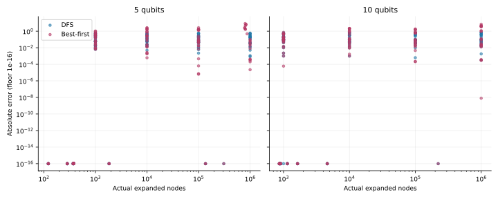
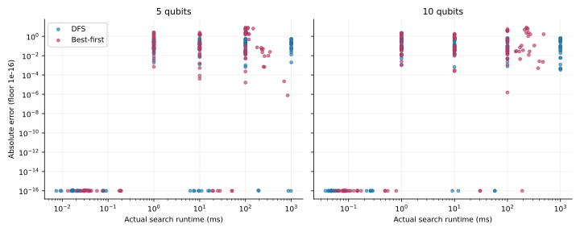
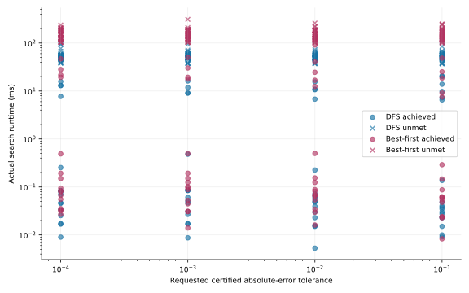
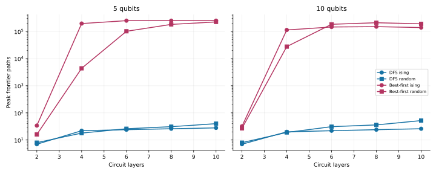
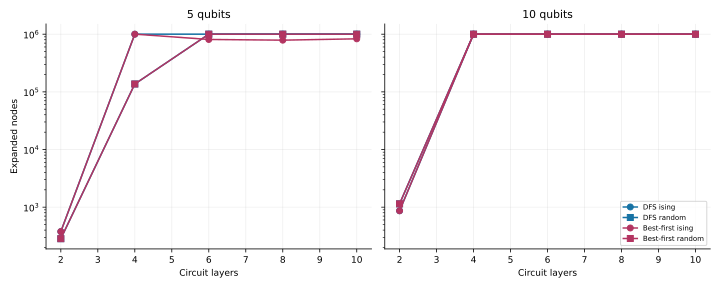
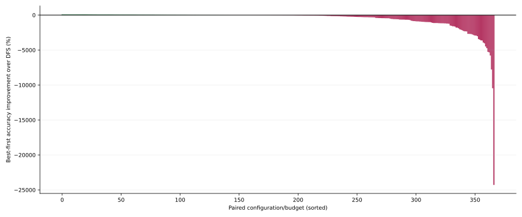
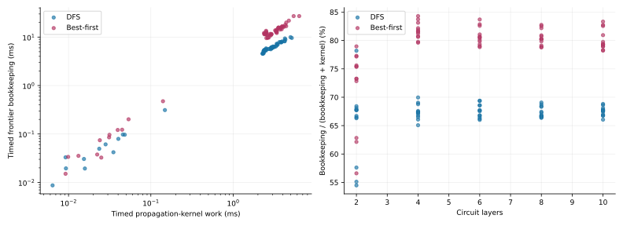

# DFS versus coefficient-prioritized best-first Pauli propagation

## 1. Research question

Does choosing the unfinished path with the largest absolute coefficient yield a more accurate completed-leaf approximation than deterministic depth-first traversal under the same expansion or wall-clock budget, and does that benefit justify heap overhead?

## 2. Methodology

Both backends use the same `PauliWord`, `Path`, Float64 gate-expansion kernel, reverse gate order, terminal overlap, compensated accumulators, resource checks, and conservative frontier bound. DFS uses an explicit LIFO stack and visits cosine/unchanged before sine; best-first uses the existing max-heap ordered by `abs(coeff)` with insertion-order ties. Neither merges or memoizes paths. The grid covers n=[5, 10, 20], both circuit families, depths [2, 4, 6, 8, 10], seeds 11 and 29, and both observables for seed 11 (Z-center for both seeds).

Expansion budgets are [1000, 10000, 100000, 1000000]; runtime budgets are [1.0, 10.0, 100.0, 1000.0] ms; certified tolerances are [0.1, 0.01, 0.001, 0.0001]. Each point has 3 post-warmup repetitions. Algorithm order alternates. Search timing excludes circuit construction, compilation warmup, and exact reference calculation. References use unmodified VectorPauliSum with no truncation. If a reference worker fails or times out, observed error is left missing. Accuracy-controlled stopping uses only the frontier bound, never the reference.

Process-lifetime RSS includes Julia, compilation, warmups, and prior cases in the worker. It is a safety/whole-process measure, not algorithm-only peak memory. Allocated bytes are traffic. The overhead figure comes from separate instrumented runs; those timers are excluded from primary timings.

## 3. Results

No on aggregate: coefficient priority did not provide a consistent equal-expansion advantage, and its accuracy was worse more often than DFS at equal wall-clock time.

At equal expansion budgets, 240 paired median points were reference-valid: best-first had lower error in 81, higher error in 99, and tied within 1e-15 in 60. The median DFS-error / best-first-error ratio among nonzero pairs was 0.995; values above one favor best-first.

At equal runtime budgets, 240 paired median points were reference-valid: best-first won 64, lost 119, and tied 57. The median nonzero error ratio was 0.628. This comparison includes priority-queue cost and runtime-check overhead.

Certified targets were achieved in 68/240 best-first points and 66/240 DFS points before the common one-second, one-million-expansion, and 250,000-frontier caps. Unmet termination reasons by algorithm are {('bestfirst', 'expansions'): 408, ('dfs', 'expansions'): 522, ('bestfirst', 'frontier'): 108}.

Both traversals certified the target in 64 paired points. In those pairs, the median best-first/DFS search-runtime ratio was 1.92 (above one means best-first took longer). At the one-million-expansion experiment, the median best-first/DFS peak-frontier ratio was 5.48e+03.

In separate instrumented runs, median bookkeeping share of measured kernel-plus-frontier time was 80.0% for best-first and 67.4% for DFS. These are direct timers around expansion and push/pop bookkeeping, not whole-runtime percentages; loop checks, terminal accumulation, and other work remain outside the denominator.

## 4. Analysis

The expansion-budget plots isolate traversal order: both methods expand the same number of nonterminal nodes unless the search finishes or hits the common frontier cap. Best-first can complete high-coefficient leaves earlier, but absolute coefficient is only a loose subtree bound. It does not know terminal overlap and cannot anticipate cancellation. DFS can therefore win when its deterministic branch happens to reach contributing I/Z leaves early, while best-first can spend many expansions maintaining broad high-mass partial paths.

The runtime-budget result is the practical comparison. A best-first accuracy advantage at equal expansions may disappear when heap operations reduce the number of paths expanded in the same time. DFS usually keeps a narrow frontier, while best-first retains many partial paths; the depth plots show the memory consequence directly.

## 5. Interpretation

A positive result requires both lower equal-expansion error and enough benefit to survive the equal-runtime comparison. The aggregate counts above answer that question for this fixed-angle grid; individual regressions and wins remain visible in the raw tables and signed-improvement plot. Upstream merged propagation is retained as an exact/reference and architectural baseline, but its term merging means it cannot diagnose traversal-order quality.

## 6. Limitations

The frontier sum is conservative and can be much larger than observed error because it ignores terminal orthogonality and cancellation. Accuracy may be nonmonotonic with budget. One-millisecond measurements are sensitive to timer granularity, scheduler noise, and per-iteration `time_ns` checks; actual elapsed time is plotted and should be used instead of assuming the requested duration. External 3 GiB/120 s guards are sampled and can overshoot. Width alone does not determine difficulty because local light cones, random gates, observable placement, and branching matter.

This is fixed-angle expectation propagation, not a parameter-uniform LOWESA surrogate guarantee. Exact references at larger/deeper configurations depend on the upstream merging implementation; missing references are never replaced with fabricated values. Instrumentation perturbs the overhead runs, so the attribution is directional rather than a cycle-accurate decomposition.

## 7. Future work

The measured evidence should determine whether a memory-bounded or hybrid strategy is justified. Plausible follow-ups are priorities incorporating remaining-gate structure, a persistent error ledger for bounded memory, and a switch from heap to DFS after a measured frontier threshold. Each would change more than traversal order and requires a separate comparison; none is implemented here.

## Figures

## Data and reproducibility

The repeat CSV contains 4440 rows; the summary contains 1440 median points. Hardware: 13th Gen Intel(R) Core(TM) i7-13700HX, 15.70 GiB RAM, Julia 1.13.4, one Julia and one BLAS thread. OS: Microsoft Windows [Version 10.0.26300.9974]. GPU detected but unused: NVIDIA GeForce RTX 4060 Laptop GPU, 610.62, 8188 MiB.

See `raw/search_repeats.csv`, `raw/search_summary.csv`, per-size JSONL, `raw/metadata.json`, and worker logs. The earlier merging-backend study remains unchanged under `../results`.
